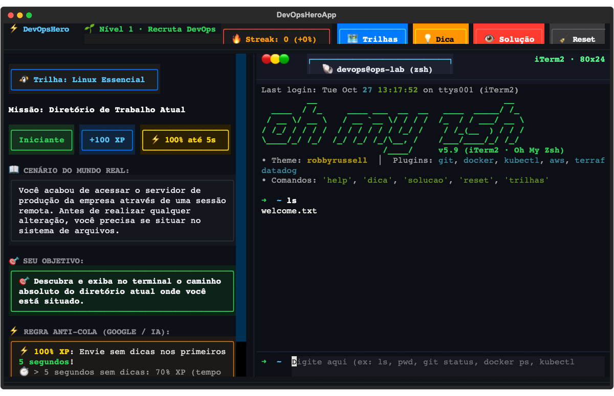

#  DevOpsHeroCLI

**Learn Linux, SysAdmin, Git, Docker, Kubernetes, AWS, Terraform and Datadog by typing real commands in a gamified interactive terminal.** 
**Aprenda Linux, SysAdmin, Git, Docker, Kubernetes, AWS, Terraform e Datadog digitando comandos reais em um terminal interativo com gamificação.**

### [🇺🇸 English](#english) · [🇧🇷 Português](#portugues)

 

---

# 🇺🇸 English

*No cloud account, no bills, and no risk of breaking your own machine.*

[Download](#en-download) •
[Mobile](#en-mobile) •
[Updates](#en-releases) •
[Tracks & missions](#en-tracks) •
[Gamification](#en-gamification) •
[Shortcuts](#en-shortcuts) •
[Commands](#en-commands)

## 💡 What is DevOpsHeroCLI?

Unlike multiple-choice quizzes or static tutorials, **DevOpsHeroCLI** simulates a complete operating environment in memory:

- **Virtual File System (VFS)**: if you create `/app/logs/access.log`, it really exists for other commands (`ls`, `grep`, `tar`, `rm`).
- **Daemons & services (`systemctl`)**: manage service state (`status`, `restart`, `enable`).
- **Container engine (`docker`)**: simulates the lifecycle of containers, images, dedicated networks and volumes.
- **Cluster orchestrator (`kubectl`)**: manage Pods, Deployments, replicas, Services and ConfigMaps.
- **Realistic observability (`datadog-agent`)**: disk/docker checks, component status and unified service tags (`DD_ENV`, `DD_SERVICE`, `DD_VERSION`).

---

## ⬇️ Download

Direct downloads of the latest version. No build or clone needed.

| Platform | Download | How to install |
|---|---|---|
|  **Linux** (Debian, Ubuntu, Mint, Pop!_OS) | [**DevOpsHero.deb**](https://github.com/araujoajoao/DevOpsHeroCLI/releases/latest/download/DevOpsHero.deb) | `sudo apt install ./DevOpsHero.deb`, then run `dh` (or open it from the app menu) |
|  **macOS** | [**DevOpsHero.dmg**](https://github.com/araujoajoao/DevOpsHeroCLI/releases/latest/download/DevOpsHero.dmg) | Open the `.dmg` and drag **DevOpsHero** into **Applications** |
|  **Windows** 10 / 11 | [**DevOpsHero-windows.zip**](https://github.com/araujoajoao/DevOpsHeroCLI/releases/latest/download/DevOpsHero-windows.zip) | Extract, open the `DevOpsHero` folder and run `.\dh.ps1` in PowerShell (or `dh.bat`). Optional shortcuts: `scripts\install_windows.ps1` |

> [!NOTE]
> The desktop apps need **Python 3.9+** (already on most Linux and macOS systems; on Windows install it from [python.org](https://www.python.org/downloads/) and tick *Add python.exe to PATH*). On first launch DevOpsHero sets up its own isolated environment automatically.

Integrity check: every release includes [`SHA256SUMS.txt`](https://github.com/araujoajoao/DevOpsHeroCLI/releases/latest/download/SHA256SUMS.txt) (`sha256sum --ignore-missing -c SHA256SUMS.txt`). All versions: [GitHub Releases](https://github.com/araujoajoao/DevOpsHeroCLI/releases).

### 📱 Mobile: 🚧 work in progress

The Android and iOS apps (same 80 missions) are being prepared for the stores.

| Android | iOS |
|:---:|:---:|
|  |  |
| 🚧 **Coming soon** to Google Play | 🚧 **Coming soon** to the App Store |

## 🔄 Updates

- The TUI shows an `Update` pill (`F6`) **only** when a newer version is available.
- To update, download the latest installer from the links above and install it over the current version. On Linux, `.deb` upgrades are picked up automatically on the next launch.

---

## 🧭 CLI commands

| Shortcut | Full command | Description |
|---|---|---|
| **`dh`** | `devopshero` | **Full TUI**: multi-pane interactive terminal with Console Home, mission explorer, XP bar, streak and Terminal Lab. |
| **`dh r`** | `devopshero repl` | **Quick prompt**: practice directly on the command line with arrow-key history and autocomplete. |
| **`dh l`** | `devopshero list` | **Mission catalog**: lists all **80 missions** and whether each is done. |
| **`dh s`** | `devopshero stats` | **Profile & stats**: your level, total XP, streak and history. |
| **`dh v`** | `devopshero verify` | **Integrity check**: runs a sandboxed self-test of all **80 missions**. |
| **`dh d`** | `devopshero doctor` | **OS & terminal check**: compatibility (Linux, macOS, Windows, WSL), UTF-8 and the active terminal. |
| **`dh update`** | `devopshero update` | **Update**: fast-forward to the latest version (git installs) or show the installer link. |
| **`dh reset`** | `devopshero reset` | **Reset progress**: start your journey from scratch. |
| **`dh -v`** | `devopshero --version` | Shows the installed version. |

> On Windows, run the same commands through the launcher: `.\dh.ps1 r`, `.\dh.ps1 l`, `.\dh.ps1 s`…

### ⚡ One-letter shortcuts in REPL mode

| Key | Long command | Action |
|:---:|---|---|
| **`d`** | `dica` / `hint` | Get a hint for the current mission (-XP) |
| **`s`** | `solucao` / `gabarito` | Reveal the solution (zero XP, breaks the streak) |
| **`n`** | `proxima` / `next` | Go to the next available challenge |
| **`r`** | `reset` | Restore the current mission's lab environment |
| **`c`** | `clear` | Clear the terminal |
| **`q`** | `sair` / `exit` | Save progress and quit |

---

## 🗺️ Learning tracks (80 missions)

###  1. Linux Essentials (10 missions)
1. **Basic navigation**: find and print the current working directory.
2. **Detailed listing**: list permissions, owners and sizes, including hidden files.
3. **Creating directories and files**: create nested structures and empty log files.
4. **Investigating logs**: filter critical errors in audit files with pipelines.
5. **Security permissions**: lock down permissions on private SSH keys.
6. **Inspecting and killing processes**: find resource-hungry processes and stop them.
7. **Output redirection**: save port inventories and append headers without overwriting.
8. **Backing up critical files**: copy production configuration files.
9. **Resource diagnostics**: check free disk space and available RAM.
10. **Safe cleanup**: remove temporary files safely.

###  2. Sysadmin Basics (10 missions)
1. **Diagnosing systemd services**: check the health and PID of the Nginx web server.
2. **Restarting database services**: apply new credentials by restarting PostgreSQL.
3. **Starting on boot**: enable essential services to start with the OS.
4. **Auditing ports and sockets**: check listening TCP ports with `ss`.
5. **Creating system users**: create accounts with a home directory and bash shell.
6. **Scheduling with crontab**: inspect recurring automation and backup jobs.
7. **Compressing directories with tar**: create `.tar.gz` archives of system directories.
8. **Auditing logs with journalctl**: query centralized systemd daemon logs.
9. **System load and uptime**: monitor uptime and load average.
10. **Admin privileges (sudo)**: grant superuser rights by adding members to the sudo group.

###  3. Git Version Control (10 missions)
1. **Initializing the repository**: create a clean Git repository for the application.
2. **Inspecting state**: check the working tree status and pending files.
3. **Staging area**: stage modified files before committing.
4. **Recording commits**: create restore points with descriptive messages.
5. **Commit history**: inspect previous commits, authors and SHAs.
6. **Branch isolation**: create and switch to feature branches.
7. **Merging changes**: merge finished features into the main branch.
8. **Remote repositories**: connect the local repository to remotes such as GitHub.
9. **Temporary stash**: stash pending changes to switch context quickly.
10. **Version tags**: create immutable tags for official production releases.

###  4. Docker & Containers (10 missions)
1. **First web container**: run web servers in the background with port mapping.
2. **Auditing running containers**: list running containers with IDs and ports.
3. **Inspecting application logs**: watch stdout/stderr of running microservices.
4. **Interactive exec**: run diagnostic commands inside production containers.
5. **Graceful stop**: stop containers safely with SIGTERM.
6. **Dedicated networks**: connect several services on an isolated bridge.
7. **Data persistence**: create dedicated volumes for durable database data.
8. **Building images**: build custom Docker images from Dockerfiles.
9. **Resource metrics**: watch CPU and memory usage live with `docker stats`.
10. **Cleanup**: remove stale containers to free host resources.

###  5. Kubernetes Orchestration (10 missions)
1. **Inspecting cluster nodes**: check the status and roles of control-plane and worker nodes.
2. **Standalone Pods**: create quick Pods for connectivity tests.
3. **All namespaces at a glance**: list workloads across every namespace.
4. **Resilient Deployments**: create managed Deployments with declared replicas.
5. **Horizontal scaling**: scale replicas to handle traffic spikes.
6. **Exposing with Services**: expose workloads through ClusterIP Services.
7. **Injecting configuration**: create ConfigMaps from literals for environment variables.
8. **Detailed troubleshooting**: investigate Pod events, failures and warnings with `describe`.
9. **Collecting Pod logs**: read startup and request logs in Kubernetes.
10. **Clean deletion**: stop and remove stale Pods and resources safely.

###  6. AWS Cloud & Infrastructure (10 missions)
1. **Identity audit**: confirm your account and authenticated user with AWS STS.
2. **Listing S3 buckets**: inspect the available object storage buckets.
3. **Creating buckets**: provision new S3 buckets for backups and logs.
4. **Uploading artifacts**: copy local release packages to cloud buckets.
5. **EC2 inventory**: describe virtual instances and their public and private IPs.
6. **Starting servers**: start EC2 instances on demand for batch workloads.
7. **Stopping idle servers**: stop EC2 instances, keeping their volumes, to cut costs.
8. **Auditing IAM identities**: list the users registered in the account.
9. **Provisioning service accounts**: create new IAM identities for CI/CD pipelines.
10. **Lambda inventory**: list active serverless functions in the AWS region.

###  7. Terraform Infrastructure as Code (10 missions)
1. **Initializing the project**: install providers and configure backends.
2. **Code formatting**: reformat HCL manifests to the official HashiCorp style.
3. **Static validation**: validate syntax and arguments before touching cloud resources.
4. **Planning changes**: preview the execution plan (`+`, `~`, `-`) with `terraform plan`.
5. **Provisioning with apply**: apply declared changes to create resources and update state.
6. **Inspecting state**: show the state file in a readable format with `terraform show`.
7. **Resource inventory**: list the managed resource addresses with `state list`.
8. **Resource details**: inspect the attributes of a single resource stored in state.
9. **Reading outputs**: extract useful output values produced by provisioning.
10. **Controlled destroy**: remove all managed resources to stop test costs.

###  8. Datadog Observability (10 missions)
1. **Agent diagnostics**: check the overall health of collectors, metrics and APM.
2. **Daemon health check**: run quick integrity tests of the monitoring process.
3. **Version audit**: identify the exact Datadog Agent version installed.
4. **Disk integration check**: run the storage plugin diagnostics.
5. **Docker integration check**: validate container metrics and socket collection.
6. **Support flare**: collect encrypted diagnostics and logs for support.
7. **Unified service tagging (environment)**: set the standard `DD_ENV` tag.
8. **Unified service tagging (service)**: set the standard `DD_SERVICE` tag.
9. **Unified service tagging (version)**: set the standard `DD_VERSION` tag.
10. **Configuration audit**: inspect the agent's consolidated configuration.

---

## 🎮 Gamification

- **⚡ Anti-cheat speed rule**:
  - **100% of points**: awarded **only** when the command is run **without hints** within the **first 5 seconds** (`<= 5.0s`). This shows real retention rather than looking it up online or asking an AI.
  - **More than 5 seconds (no hints)**: 70% of the base points.
  - **Progressive hint penalty**: each hint (F3 or the `dica` command) lowers your score:
    - 💡 **1 hint**: 40% of XP
    - 💡 **2 hints**: 20% of XP
    - 💡 **3+ hints**: 10% of XP (a minimum, to encourage finishing)
  - **👁️ Solution revealed (F4 / `solucao`)**: zero XP for the mission and the streak resets to 0.
- **XP and levels (10 ranks)**:
  - 🌱 **Level 1 · DevOps Recruit** (0–249 XP)
  -  **Level 2 · Sysadmin Basics** (250–599 XP)
  -  **Level 3 · Linux Explorer** (600–1099 XP)
  -  **Level 4 · Git Codecrafter** (1100–1699 XP)
  -  **Level 5 · Container Captain** (1700–2499 XP)
  -  **Level 6 · Cluster Commander** (2500–3499 XP)
  -  **Level 7 · Cloud Architect** (3500–4699 XP)
  -  **Level 8 · IaC Master** (4700–6199 XP)
  -  **Level 9 · Observability Guru** (6200–7999 XP)
  - ⚡ **Level 10 · DevOps Titan** (8000+ XP)
- **Streak 🔥**: consecutive correct answers without revealing the solution give up to **+50% bonus XP**.
- **Automatic local save**: progress is stored in `~/.devopsherocli/progress.json`.

---

## ⌨️ Keyboard shortcuts

| Key | Action |
|---|---|
| `F1` | Help and command summary |
| `F2` | Open the track and mission picker |
| `F3` | Show or hide the current mission's hint |
| `F4` | Reveal the solution (resets the streak) |
| `F5` | Reset the lab to the mission's initial state |
| `F6` | Check for and apply updates |
| `Ctrl + L` | Clear the terminal log |
| `Ctrl + Q` | Quit safely |

---

## 🎨 Visual identity & icons

The official DevOpsHero logo (graduation cap, laptop and the DevOps ∞ loop) is [assets/logo.png](assets/logo.png): the mobile app icon with a transparent background. The full app icon with its rounded background is [devopshero-mobile/assets/icon.png](devopshero-mobile/assets/icon.png), identical to the SwiftUI app's `AppIcon-1024.png`.

Technology and platform logos used in this README live in [assets/icons/](assets/icons) as brand-colored SVGs (from [Simple Icons](https://simpleicons.org), CC0; AWS from [Devicon](https://devicon.dev), MIT; Windows drawn from its four-pane mark). Black marks are drawn in neutral gray so they stay visible in light and dark themes. Each logo is a trademark of its owner.

Native desktop icons (macOS Dock/Launchpad and the Windows shortcut) are generated from the vector [assets/icon.svg](assets/icon.svg), following Apple's macOS Human Interface Guidelines:
- **Geometry**: continuous superellipse (an 824×824 *squircle* centered on a 1024×1024 canvas).
- **Pure alpha**: a fully transparent outer background (`alpha = 0`), so no unwanted plate appears in the Dock or Launchpad.
- **Native Swift pipeline**: [`scripts/build_icons.sh`](scripts/build_icons.sh) builds the derived formats with `AppKit` (`NSGraphicsContext`):
  - `assets/DevOpsHero.icns` (10 Retina sizes, 16px to 1024px)
  - `assets/DevOpsHero.ico` (multi-size, for Windows)

---

## 🤝 Contributing

Contributions are very welcome!

1. Read [CONTRIBUTING.md](.github/CONTRIBUTING.md): it covers running from source, tests, building installers, the mobile apps and releases.
2. Create a topic branch from `main` (`git checkout -b feat/new-track` or `fix/bug-name`).
3. Follow Conventional Commits (`feat:`, `fix:`, `docs:`, `test:`).
4. Run the tests locally (`make test`).
5. Open a pull request using the [template](.github/pull_request_template.md).

---

## 📄 License

Released under the **MIT** license. See [LICENSE](LICENSE) for details.

Built by **[João Araújo](https://github.com/araujoajoao)**.

<a href="#">⬆ Back to top</a>

---

# 🇧🇷 Português

*Sem precisar de nuvem, sem pagar contas e sem risco de quebrar sua máquina.*

[Download](#pt-download) •
[Mobile](#pt-mobile) •
[Atualizações](#pt-releases) •
[Trilhas e missões](#pt-tracks) •
[Gamificação](#pt-gamification) •
[Atalhos](#pt-shortcuts) •
[Comandos](#pt-commands)

## 💡 O que é o DevOpsHeroCLI?

Diferente de quizzes de múltipla escolha ou tutoriais estáticos, o **DevOpsHeroCLI** simula um ambiente operacional completo em memória:

- **Sistema de Arquivos Virtual (VFS)**: se você cria `/app/logs/access.log`, ele passa a existir de verdade para outros comandos (`ls`, `grep`, `tar`, `rm`).
- **Daemons e serviços (`systemctl`)**: gerencie o estado de serviços (`status`, `restart`, `enable`).
- **Mecanismo de contêineres (`docker`)**: simula o ciclo de vida de contêineres, imagens, redes dedicadas e volumes.
- **Orquestrador de clusters (`kubectl`)**: gerencie Pods, Deployments, réplicas, Services e ConfigMaps.
- **Observabilidade realista (`datadog-agent`)**: checks de disco/docker, status de componentes e tags unificadas de serviço (`DD_ENV`, `DD_SERVICE`, `DD_VERSION`).

---

## ⬇️ Download

Downloads diretos da versão mais recente. Não precisa compilar nem clonar nada.

| Plataforma | Download | Como instalar |
|---|---|---|
|  **Linux** (Debian, Ubuntu, Mint, Pop!_OS) | [**DevOpsHero.deb**](https://github.com/araujoajoao/DevOpsHeroCLI/releases/latest/download/DevOpsHero.deb) | `sudo apt install ./DevOpsHero.deb` e depois rode `dh` (ou abra pelo menu de aplicativos) |
|  **macOS** | [**DevOpsHero.dmg**](https://github.com/araujoajoao/DevOpsHeroCLI/releases/latest/download/DevOpsHero.dmg) | Abra o `.dmg` e arraste o **DevOpsHero** para **Applications** |
|  **Windows** 10 / 11 | [**DevOpsHero-windows.zip**](https://github.com/araujoajoao/DevOpsHeroCLI/releases/latest/download/DevOpsHero-windows.zip) | Extraia, abra a pasta `DevOpsHero` e rode `.\dh.ps1` no PowerShell (ou `dh.bat`). Atalhos opcionais: `scripts\install_windows.ps1` |

> [!NOTE]
> Os apps de desktop precisam do **Python 3.9+** (já presente na maioria dos Linux e macOS; no Windows, instale pelo [python.org](https://www.python.org/downloads/) marcando *Add python.exe to PATH*). Na primeira execução o DevOpsHero configura sozinho o próprio ambiente isolado.

Verificação de integridade: todo release inclui o [`SHA256SUMS.txt`](https://github.com/araujoajoao/DevOpsHeroCLI/releases/latest/download/SHA256SUMS.txt) (`sha256sum --ignore-missing -c SHA256SUMS.txt`). Todas as versões: [GitHub Releases](https://github.com/araujoajoao/DevOpsHeroCLI/releases).

### 📱 Mobile: 🚧 em desenvolvimento

Os apps Android e iOS (com as mesmas 80 missões) estão sendo preparados para as lojas.

| Android | iOS |
|:---:|:---:|
|  |  |
| 🚧 **Em breve** na Google Play | 🚧 **Em breve** na App Store |

## 🔄 Atualizações

- A TUI mostra a pílula `Update` (`F6`) **somente** quando existe uma versão mais nova.
- Para atualizar, baixe o instalador mais recente pelos links acima e instale por cima da versão atual. No Linux, o upgrade do `.deb` é aplicado automaticamente na próxima execução.

---

## 🧭 Comandos da CLI

| Atalho | Comando completo | Descrição |
|---|---|---|
| **`dh`** | `devopshero` | **Interface TUI completa**: terminal interativo multi-painel com Console Home, explorer de missões, barra de XP, streak e Terminal Lab. |
| **`dh r`** | `devopshero repl` | **Prompt rápido**: pratique direto na linha de comando com histórico pelas setas e autocomplete. |
| **`dh l`** | `devopshero list` | **Catálogo de missões**: lista as **80 missões** e o status de cada uma. |
| **`dh s`** | `devopshero stats` | **Perfil e estatísticas**: nível, XP acumulado, sequência (streak) e histórico. |
| **`dh v`** | `devopshero verify` | **Diagnóstico de integridade**: autoteste em sandbox de todas as **80 missões**. |
| **`dh d`** | `devopshero doctor` | **Diagnóstico de SO e terminal**: compatibilidade (Linux, macOS, Windows, WSL), UTF-8 e terminal ativo. |
| **`dh update`** | `devopshero update` | **Atualização**: avança para a versão mais recente (instalações via git) ou mostra o link do instalador. |
| **`dh reset`** | `devopshero reset` | **Reset de progresso**: recomeça a jornada do zero. |
| **`dh -v`** | `devopshero --version` | Mostra a versão instalada. |

> No Windows, use os mesmos comandos pelo launcher: `.\dh.ps1 r`, `.\dh.ps1 l`, `.\dh.ps1 s`…

### ⚡ Atalhos de 1 letra no modo REPL

| Tecla | Comando longo | Ação |
|:---:|---|---|
| **`d`** | `dica` / `hint` | Pede uma dica da missão atual (-XP) |
| **`s`** | `solucao` / `gabarito` | Revela a solução (zera o XP e quebra o streak) |
| **`n`** | `proxima` / `next` | Avança para o próximo desafio disponível |
| **`r`** | `reset` | Restaura o laboratório da missão atual |
| **`c`** | `clear` | Limpa a tela do terminal |
| **`q`** | `sair` / `exit` | Salva o progresso e encerra |

---

## 🗺️ Trilhas de aprendizado (80 missões)

###  1. Linux Essencial (10 missões)
1. **Navegação básica**: descubra e exiba o diretório de trabalho atual.
2. **Listagem detalhada**: liste permissões, donos e tamanhos, incluindo arquivos ocultos.
3. **Criação de diretórios e arquivos**: crie estruturas aninhadas e arquivos de log vazios.
4. **Investigação de logs**: filtre erros críticos em arquivos de auditoria com pipelines.
5. **Permissões de segurança**: restrinja as permissões de chaves SSH privadas.
6. **Inspeção e encerramento de processos**: identifique processos com alto consumo e finalize-os.
7. **Redirecionamento de saída**: salve inventários de portas e adicione cabeçalhos sem sobrescrever.
8. **Backup de arquivos críticos**: copie arquivos de configuração de produção.
9. **Diagnóstico de recursos**: analise o espaço livre em disco e a RAM disponível.
10. **Remoção segura**: elimine arquivos temporários com segurança.

###  2. Sysadmin Básico (10 missões)
1. **Diagnóstico de serviços systemd**: verifique a saúde e o PID do servidor web Nginx.
2. **Reinício de serviços de banco**: aplique novas credenciais reiniciando o PostgreSQL.
3. **Persistência no boot**: habilite serviços essenciais para iniciar com o SO.
4. **Auditoria de portas e sockets**: verifique portas TCP em escuta com `ss`.
5. **Criação de usuários de sistema**: crie contas com diretório home e shell bash.
6. **Agendamento com crontab**: inspecione rotinas periódicas de automação e backup.
7. **Compactação com tar**: crie arquivos `.tar.gz` de diretórios do sistema.
8. **Auditoria de logs com journalctl**: consulte logs centralizados dos daemons do systemd.
9. **Carga e uptime**: monitore o tempo de atividade e o load average.
10. **Privilégios administrativos (sudo)**: conceda poderes de superusuário adicionando membros ao grupo sudo.

###  3. Git Controle de Versão (10 missões)
1. **Inicializando o repositório**: crie um repositório Git limpo para a aplicação.
2. **Inspecionando o estado**: consulte o status da árvore de trabalho e os arquivos pendentes.
3. **Área de staging**: mova arquivos modificados para a staging area antes do commit.
4. **Gravando commits**: registre pontos de restauração com mensagens descritivas.
5. **Histórico de commits**: inspecione commits anteriores, autores e SHAs.
6. **Isolamento em branches**: crie e ative branches de feature.
7. **Mesclando alterações**: faça merge de funcionalidades prontas na branch principal.
8. **Repositórios remotos**: conecte o repositório local a remotos como o GitHub.
9. **Stash temporário**: guarde alterações pendentes no stash para trocar de contexto.
10. **Tags de versão**: crie tags imutáveis para releases oficiais de produção.

###  4. Docker & Contêineres (10 missões)
1. **Primeiro contêiner web**: execute servidores web em background mapeando portas.
2. **Auditoria de contêineres ativos**: liste contêineres em execução com IDs e portas.
3. **Inspeção de logs da aplicação**: acompanhe stdout/stderr de microsserviços em execução.
4. **Execução interativa**: rode comandos de diagnóstico dentro de contêineres em produção.
5. **Parada graciosa**: interrompa contêineres com SIGTERM de forma segura.
6. **Redes dedicadas**: conecte vários serviços em uma bridge isolada.
7. **Persistência de dados**: crie volumes dedicados para dados duráveis de banco.
8. **Build de imagens**: construa imagens Docker personalizadas a partir de Dockerfiles.
9. **Métricas de recursos**: acompanhe CPU e memória em tempo real com `docker stats`.
10. **Limpeza**: remova contêineres obsoletos para liberar recursos do host.

###  5. Kubernetes Orquestração (10 missões)
1. **Inspeção dos nós do cluster**: verifique o status e o papel dos nós control-plane e worker.
2. **Pods standalone**: crie Pods rápidos para testes de conectividade.
3. **Visão de todos os namespaces**: liste cargas de trabalho em todos os namespaces.
4. **Deployments resilientes**: crie Deployments gerenciados com réplicas declaradas.
5. **Escalonamento horizontal**: escale réplicas para suportar picos de tráfego.
6. **Exposição com Services**: exponha cargas de trabalho com Services ClusterIP.
7. **Injeção de configurações**: crie ConfigMaps a partir de literais para variáveis de ambiente.
8. **Troubleshooting detalhado**: investigue eventos, falhas e alertas de Pods com `describe`.
9. **Coleta de logs de Pods**: leia logs de inicialização e de requisições no Kubernetes.
10. **Remoção limpa**: encerre e remova Pods e recursos obsoletos com segurança.

###  6. AWS Cloud & Infraestrutura (10 missões)
1. **Auditoria de identidade**: confirme sua conta e o usuário autenticado com o AWS STS.
2. **Listagem de buckets S3**: inspecione os buckets de armazenamento disponíveis.
3. **Criação de buckets**: provisione novos buckets S3 para backups e logs.
4. **Upload de artefatos**: envie pacotes de release locais para buckets na nuvem.
5. **Inventário EC2**: descreva instâncias virtuais e seus IPs públicos e privados.
6. **Iniciando servidores**: inicie instâncias EC2 sob demanda para cargas batch.
7. **Parando servidores ociosos**: pare instâncias EC2, preservando os volumes, para reduzir custos.
8. **Auditoria de identidades IAM**: liste os usuários cadastrados na conta.
9. **Provisionando contas de serviço**: crie novas identidades IAM para esteiras de CI/CD.
10. **Inventário Lambda**: liste as funções serverless ativas na região AWS.

###  7. Terraform Infraestrutura como Código (10 missões)
1. **Inicialização do projeto**: instale provedores e configure backends.
2. **Padronização de código**: reformate manifestos HCL no padrão oficial da HashiCorp.
3. **Validação estática**: valide sintaxe e argumentos antes de tocar nos recursos de nuvem.
4. **Planejamento de mudanças**: preveja o plano de execução (`+`, `~`, `-`) com `terraform plan`.
5. **Provisionamento com apply**: aplique as mudanças declaradas para criar recursos e atualizar o estado.
6. **Inspeção do estado**: exiba o arquivo de estado em formato legível com `terraform show`.
7. **Inventário de recursos**: liste os endereços dos recursos gerenciados com `state list`.
8. **Detalhamento de recurso**: inspecione os atributos de um recurso salvo no estado.
9. **Consultando outputs**: extraia os valores de saída gerados pelo provisionamento.
10. **Destruição controlada**: remova todos os recursos gerenciados para zerar custos de teste.

###  8. Datadog Observabilidade (10 missões)
1. **Diagnóstico do Agent**: verifique a saúde geral de coletores, métricas e APM.
2. **Health check do daemon**: rode testes rápidos de integridade do processo de monitoramento.
3. **Auditoria de versão**: identifique a versão exata do Datadog Agent instalada.
4. **Check de integração de disco**: rode o diagnóstico do plugin de armazenamento.
5. **Check de integração Docker**: valide a coleta de métricas de contêineres e sockets.
6. **Flare de suporte**: colete diagnósticos e logs criptografados para o suporte.
7. **Unified service tagging (ambiente)**: configure a tag padronizada `DD_ENV`.
8. **Unified service tagging (serviço)**: configure a tag padronizada `DD_SERVICE`.
9. **Unified service tagging (versão)**: configure a tag padronizada `DD_VERSION`.
10. **Auditoria de configurações**: inspecione a configuração consolidada do agente.

---

## 🎮 Gamificação

- **⚡ Regra anti-cola de velocidade**:
  - **100% dos pontos**: concedidos **apenas** quando o comando é executado **sem dicas** nos **primeiros 5 segundos** (`<= 5.0s`). Isso comprova a fixação do conteúdo em vez de consultas a pesquisas ou IA.
  - **Mais de 5 segundos (sem dicas)**: 70% dos pontos base.
  - **Penalidade progressiva por dicas**: cada dica (F3 ou o comando `dica`) reduz a pontuação:
    - 💡 **1 dica**: 40% do XP
    - 💡 **2 dicas**: 20% do XP
    - 💡 **3+ dicas**: 10% do XP (mínimo garantido para incentivar a conclusão)
  - **👁️ Gabarito revelado (F4 / `solucao`)**: zera o XP da missão e o streak volta a 0.
- **XP e níveis (10 patentes)**:
  - 🌱 **Nível 1 · Recruta DevOps** (0–249 XP)
  -  **Nível 2 · Sysadmin Básico** (250–599 XP)
  -  **Nível 3 · Linux Explorer** (600–1099 XP)
  -  **Nível 4 · Git Codecrafter** (1100–1699 XP)
  -  **Nível 5 · Container Captain** (1700–2499 XP)
  -  **Nível 6 · Cluster Commander** (2500–3499 XP)
  -  **Nível 7 · Cloud Architect** (3500–4699 XP)
  -  **Nível 8 · IaC Master** (4700–6199 XP)
  -  **Nível 9 · Observability Guru** (6200–7999 XP)
  - ⚡ **Nível 10 · DevOps Titan** (8000+ XP)
- **Sequência (streak 🔥)**: acertos seguidos sem revelar o gabarito dão até **+50% de bônus de XP**.
- **Salvamento local automático**: o progresso fica em `~/.devopsherocli/progress.json`.

---

## ⌨️ Atalhos do teclado

| Tecla | Ação |
|---|---|
| `F1` | Ajuda e resumo dos comandos |
| `F2` | Abre o seletor de trilhas e missões |
| `F3` | Mostra ou oculta a dica da missão atual |
| `F4` | Revela o gabarito (zera o streak) |
| `F5` | Restaura o laboratório para o estado inicial da missão |
| `F6` | Verifica e aplica atualizações |
| `Ctrl + L` | Limpa o log do terminal |
| `Ctrl + Q` | Encerra com segurança |

---

## 🎨 Identidade visual e ícones

O logo oficial do DevOpsHero (capelo, laptop e o laço ∞ do DevOps) é o [assets/logo.png](assets/logo.png): o ícone do app mobile com fundo transparente. O ícone completo do app, com fundo arredondado, é o [devopshero-mobile/assets/icon.png](devopshero-mobile/assets/icon.png), idêntico ao `AppIcon-1024.png` do app SwiftUI.

Os logos de tecnologias e plataformas usados neste README ficam em [assets/icons/](assets/icons), como SVGs nas cores oficiais das marcas (do [Simple Icons](https://simpleicons.org), CC0; AWS do [Devicon](https://devicon.dev), MIT; Windows desenhado a partir da marca de quatro painéis). Marcas pretas são desenhadas em cinza neutro para continuarem visíveis nos temas claro e escuro. Cada logo é marca registrada do respectivo dono.

Os ícones nativos de desktop (Dock/Launchpad no macOS e atalho no Windows) são gerados a partir do vetor [assets/icon.svg](assets/icon.svg), seguindo as Human Interface Guidelines da Apple para macOS:
- **Geometria**: superelipse contínua (*squircle* de 824×824 centralizado em canvas de 1024×1024).
- **Alfa puro**: fundo externo 100% transparente (`alpha = 0`), sem placa ou moldura indesejada no Dock e no Launchpad.
- **Pipeline nativo em Swift**: o [`scripts/build_icons.sh`](scripts/build_icons.sh) gera os formatos derivados com `AppKit` (`NSGraphicsContext`):
  - `assets/DevOpsHero.icns` (10 resoluções Retina, de 16px a 1024px)
  - `assets/DevOpsHero.ico` (múltiplas resoluções, para Windows)

---

## 🤝 Contribuições

Contribuições são muito bem-vindas!

1. Leia o [CONTRIBUTING.md](.github/CONTRIBUTING.md): ele explica como rodar do código-fonte, testes, build dos instaladores, apps mobile e releases.
2. Crie uma branch temática a partir da `main` (`git checkout -b feat/nova-trilha` ou `fix/nome-do-bug`).
3. Siga o padrão Conventional Commits (`feat:`, `fix:`, `docs:`, `test:`).
4. Rode os testes localmente (`make test`).
5. Abra um pull request usando o [modelo padrão](.github/pull_request_template.md).

---

## 📄 Licença

Distribuído sob a licença **MIT**. Consulte o arquivo [LICENSE](LICENSE) para mais informações.

Desenvolvido por **[João Araújo](https://github.com/araujoajoao)**.

<a href="#">⬆ Voltar ao topo</a>

