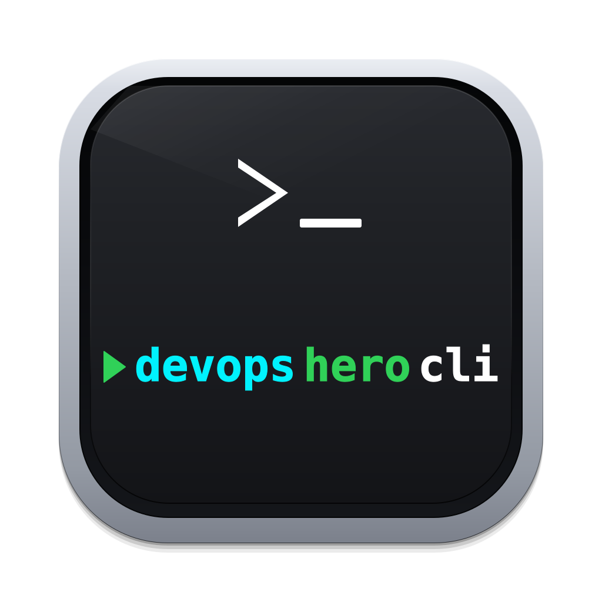
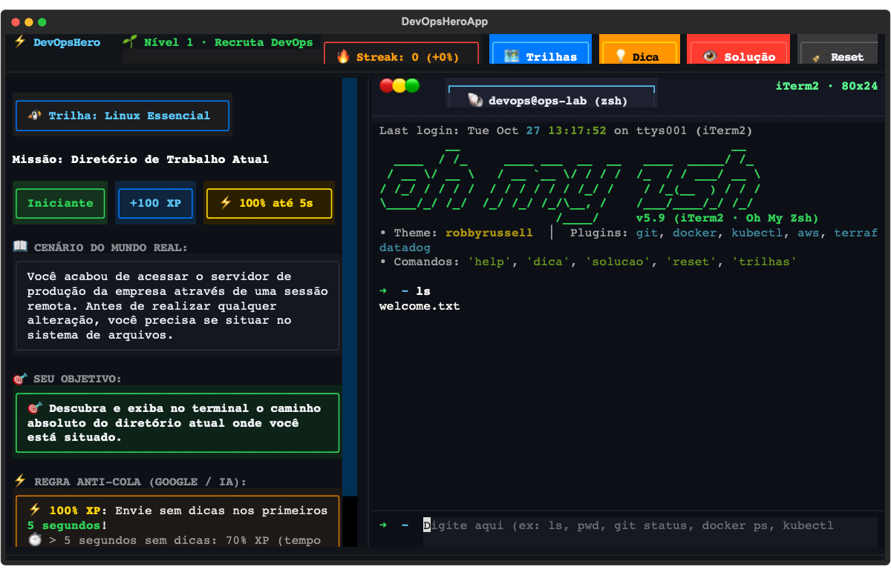

# ⚡ DevOpsHeroCLI — Treinador Interativo de CLI DevOps

<div align="center">




[](https://github.com/araujoajoao/DevOpsHeroCLI/releases)
[](https://github.com/araujoajoao/DevOpsHeroCLI/actions/workflows/ci.yml)
[](#-revisão-automática-por-ia-no-github)
[](https://www.python.org/downloads/)
[](https://opensource.org/licenses/MIT)
[](#-o-que-%C3%A9-o-devopsherocli)
[](#️-trilhas-de-aprendizado-80-missões)

**Aprenda Linux, SysAdmin, Git, Docker, Kubernetes, AWS, Terraform e Datadog digitando comandos reais em um terminal interativo com gamificação.**  
*Sem precisar de nuvem, sem pagar contas e sem risco de quebrar sua máquina física.*

> **English Overview:** *DevOpsHeroCLI is an interactive, gamified terminal simulator designed to teach **Linux, Sysadmin, Git, Docker, Kubernetes, AWS CLI, Terraform, and Datadog** through hands-on CLI practice. Features an authentic **iTerm2 + Oh My Zsh** interface, in-memory virtual state engines, and anti-cheat speed scoring.*

[Como Rodar](#-como-rodar-localmente-em-1-minuto) •
[App macOS](#app-macos) •
[Trilhas & Missões](#️-trilhas-de-aprendizado-80-missões) •
[Gamificação](#-sistema-de-gamificação) •
[Atalhos](#️-atalhos-do-teclado) •
[AI Reviewer](#-revisão-automática-por-ia-no-github) •
[Docker](#-executando-com-docker-sem-instalar-python) •
[Testes](#-testes-automatizados)

<br/>



</div>

---

## 💡 O que é o DevOpsHeroCLI?

Diferente de quizzes com múltipla escolha ou tutoriais estáticos, o **DevOpsHeroCLI** simula um ambiente operacional completo em memória:

- **Sistema de Arquivos Virtual (VFS)**: se você cria `/app/logs/access.log`, ele passa a existir de verdade para outros comandos (`ls`, `grep`, `tar`, `rm`).
- **Daemons & Serviços (`systemctl`)**: gerencie o estado de serviços (`status`, `restart`, `enable`).
- **Mecanismo de Contêineres (`docker`)**: simula ciclo de vida de contêineres, imagens, redes dedicadas e volumes.
- **Orquestrador de Clusters (`kubectl`)**: gerencie Pods, Deployments, Réplicas, Services e ConfigMaps.
- **Observabilidade Realista (`datadog-agent`)**: checks de disco/docker, status de componentes e tags unificadas de serviço (`DD_ENV`, `DD_SERVICE`, `DD_VERSION`).

---

## 🚀 Como Rodar Localmente em 1 Minuto

### ⚡ Opção Recomendada: Execução Direta (Zero-Clone / Download Mínimo)

Se você quer apenas jogar e aprender sem precisar baixar o repositório completo, testes ou documentação:

```bash
# Usando pipx (cria ambiente isolado e executa instantaneamente):
pipx run --spec git+https://github.com/araujoajoao/DevOpsHeroCLI.git dh

# Ou instalando globalmente via pip:
pip install git+https://github.com/araujoajoao/DevOpsHeroCLI.git
dh              # Inicia a Interface Visual Completa
dh r            # Modo REPL Rápido
```

---

### 📂 Opção via Repositório Git (Passo a Passo por Sistema Operacional)

Se preferir clonar o código-fonte para rodar localmente ou contribuir:

```bash
# 1. Clone leve (baixa apenas o estado atual, sem histórico antigo pesado)
git clone --depth=1 https://github.com/araujoajoao/DevOpsHeroCLI.git
cd DevOpsHeroCLI
```

Agora execute de acordo com o seu Sistema Operacional:

---

#### 🐧 1. Linux (Ubuntu, Debian, Fedora, Arch) ou WSL

Abra o seu terminal favorito (**Bash** ou **Zsh**) e execute o launcher oficial:

```bash
./dh            # Inicia a Interface TUI Completa imediatamente
./dh r          # Modo Prompt REPL Rápido (sem divisão de tela)
./dh s          # Estatísticas do perfil e XP acumulado
./dh l          # Catálogo completo das 80 missões
./dh d          # Diagnóstico do SO e compatibilidade de terminal
```

> [!NOTE]
> Na primeira execução, o script `./dh` cria o ambiente virtual `.venv` e instala as dependências automaticamente de forma isolada.

---

#### 🍎 2. macOS (MacBook, iMac, Mac mini)

No macOS você tem duas formas excelentes de rodar:

##### Opção 2.1 — Pelo Terminal (iTerm2 ou Terminal.app)
```bash
./dh            # Inicia a Interface Completa diretamente no terminal
./dh r          # Modo Prompt REPL Rápido
```

<a id="app-macos"></a>
##### Opção 2.2 — Aplicativo Nativo no Launchpad & `/Applications` (.app / .dmg)
Se você deseja ter o **ícone oficial** no seu Launchpad, Spotlight e pasta `/Applications`:

```bash
# 1. O instalador oficial já vem pré-compilado no repositório! Basta abrir no Finder:
open dist/DevOpsHero.dmg

# (Opcional) Caso queira recompilar o instalador do zero a qualquer momento:
make dmg
```

> **Instalação**: Ao abrir a imagem, basta arrastar o ícone **DevOpsHero** para a pasta **Applications**. Ele fica disponível no Spotlight e Launchpad com ícone oficial Retina!

---

#### 🪟 3. Windows (10 e 11)

Escolha o terminal do Windows que você costuma usar:

##### Opção 3.1 — No PowerShell (Recomendado)
```powershell
.\dh.ps1        # Inicia a Interface TUI Completa imediatamente
.\dh.ps1 r      # Modo Prompt REPL Rápido
.\dh.ps1 s      # Estatísticas do perfil e XP acumulado
.\dh.ps1 l      # Catálogo completo das 80 missões
.\dh.ps1 d      # Diagnóstico do SO e compatibilidade
```

##### Opção 3.2 — No Prompt de Comando Clássico (CMD)
```cmd
dh.bat          # Inicia a Interface Completa
dh.bat r        # Modo REPL Rápido
```

> [!TIP]
> **Usuários de WSL (Windows Subsystem for Linux)**: Se você usa WSL no Windows, basta abrir seu terminal Linux (Ubuntu/Debian) e rodar `./dh`.

---

#### 📦 4. Instalação Global no Sistema via Pip (Qualquer OS)

Se quiser que o comando **`dh`** funcione globalmente em qualquer pasta do seu terminal:

```bash
python3 -m venv .venv
source .venv/bin/activate       # No Windows: .venv\Scripts\Activate.ps1
pip install -e .

dh              # Executa a interface de qualquer pasta
dh r            # Modo prompt interativo rápido
dh s            # Estatísticas do perfil e XP
dh d            # Diagnóstico de SO e compatibilidade
```

---

## 🐳 Executando com Docker (Sem Instalar Python)

Se você não tiver Python instalado na máquina ou preferir isolamento total:

```bash
# Usando Docker Compose com persistência de progresso:
docker compose -f docker/docker-compose.yml run --rm devopshero

# Ou via Makefile:
make docker

# Ou construindo a imagem manualmente:
docker build -f docker/Dockerfile -t devopshero .
docker run -it --rm devopshero
```

---

## 🧭 Comandos do CLI (Digitação Rápida)

| Atalho Ultra-Rápido | Comando Completo | Descrição |
|---|---|---|
| **`dh`** | `./dh` ou `devopshero` | **Interface TUI Completa**: Tela dividida estilo iTerm2/macOS com card de missão, barra de XP, streak e terminal. |
| **`dh r`** | `./dh r` ou `devopshero repl` | **Modo Prompt Rápido**: Pratique direto na linha de comando com histórico de setas e autocomplete. |
| **`dh l`** | `./dh l` ou `devopshero list` | **Catálogo de Missões**: Lista todas as **80 missões** e status concluído/pendente. |
| **`dh s`** | `./dh s` ou `devopshero stats` | **Perfil & Estatísticas**: Exibe seu nível, XP acumulado, sequência (streak) e histórico. |
| **`dh v`** | `./dh v` ou `devopshero verify` | **Diagnóstico de Integridade**: Executa auto-teste em sandbox validando todas as **80 missões**. |
| **`dh d`** | `./dh d` ou `devopshero doctor` | **Diagnóstico de SO & Terminal**: Inspeciona compatibilidade (Linux, macOS, Windows, WSL), UTF-8 e terminal ativo. |
| **`dh reset`** | `./dh reset` ou `devopshero reset` | **Reset de Progresso**: Restaura seu progresso caso deseje reiniciar a jornada do zero. |
| **`dh -v`** | `devopshero --version` | Exibe a versão instalada do DevOpsHeroCLI. |

---

## ⚡ Atalhos de 1 Letra no Modo REPL (Em Jogo)

Durante o treinamento interativo, digite apenas uma letra para ações frequentes:

| Letra / Atalho | Comando Longo | Ação no Treinamento |
|:---:|---|---|
| **`d`** | `dica` / `hint` | Solicita uma dica prática da missão atual (-XP) |
| **`s`** | `solucao` / `gabarito` | Revela a solução da missão (zera XP e quebra streak) |
| **`n`** | `proxima` / `next` | Avança para o próximo desafio disponível |
| **`r`** | `reset` | Restaura o ambiente do laboratório da missão atual |
| **`c`** | `clear` | Limpa a tela do terminal |
| **`q`** | `sair` / `exit` | Salva o progresso e encerra a sessão |

---

## 🗺️ Trilhas de Aprendizado (80 Missões)

### 🐧 1. Linux Essencial (10 Missões)
1. **Navegação Básica**: Descubra e exiba o caminho do diretório de trabalho atual.
2. **Listagem Detalhada**: Liste permissões, donos e tamanhos de arquivos ocultos.
3. **Criação de Diretórios e Arquivos**: Crie estruturas aninhadas e arquivos vazios de logs.
4. **Investigação de Logs**: Filtre erros críticos em arquivos de auditoria com pipelines.
5. **Permissões de Segurança**: Ajuste permissões estritas em chaves SSH privadas.
6. **Inspeção e Encerramento de Processos**: Identifique processos com alto consumo e finalize-os.
7. **Redirecionamento de Saída**: Salve inventários de portas e adicione cabeçalhos sem sobrescrever.
8. **Backup de Arquivos Críticos**: Duplique arquivos de configuração de produção.
9. **Diagnóstico de Recursos**: Analise espaço livre em disco e memória RAM disponível.
10. **Remoção Segura de Lixo**: Elimine arquivos temporários com segurança.

### 🛠️ 2. Sysadmin Básico (10 Missões)
1. **Diagnóstico de Serviços Systemd**: Inspecione a saúde e PID do servidor web Nginx.
2. **Reinício de Serviços de Banco**: Aplique novas credenciais reiniciando o serviço PostgreSQL.
3. **Persistência no Boot**: Habilite serviços essenciais para iniciar automaticamente com o SO.
4. **Auditoria de Portas e Sockets**: Verifique portas TCP abertas em modo de escuta com `ss`.
5. **Criação de Usuários de Sistema**: Crie contas com diretório home e shell bash configurados.
6. **Agendamento de Tarefas com Crontab**: Inspecione rotinas periódicas de automação e backup.
7. **Compactação de Diretórios com Tar**: Crie arquivos comprimidos `.tar.gz` de diretórios do sistema.
8. **Auditoria de Logs com Journalctl**: Consulte logs centralizados de daemons do systemd.
9. **Carga e Uptime do Sistema**: Monitore o tempo de atividade e média de carga (load average).
10. **Privilégios Administrativos (Sudo)**: Conceda poderes de superusuário adicionando membros ao grupo sudo.

### 🌿 3. Git Controle de Versão (10 Missões)
1. **Inicializando o Repositório**: Crie um repositório Git limpo para versionar a aplicação.
2. **Inspecionando o Estado**: Consulte o status da árvore de trabalho e arquivos pendentes.
3. **Área de Staging**: Mova arquivos modificados para a staging area antes do commit.
4. **Gravando Commits**: Registre pontos de restauração com mensagens descritivas.
5. **Histórico de Commits**: Inspecione commits anteriores, autores e identificadores sha.
6. **Isolamento em Branches**: Crie e ative branches de feature para desenvolvimento paralelo.
7. **Mesclando Alterações**: Faça merge de funcionalidades finalizadas na branch principal.
8. **Repositórios Remotos**: Conecte o repositório local a servidores remotos como GitHub.
9. **Stash Temporário**: Guarde alterações pendentes no stash para trocar de contexto rapidamente.
10. **Tags de Versão**: Crie tags imutáveis para marcar releases oficiais de produção.

### 🐳 4. Docker & Contêineres (10 Missões)
1. **Primeiro Contêiner Web**: Execute servidores web em background mapeando portas para o host.
2. **Auditoria de Contêineres Ativos**: Liste contêineres em execução com seus IDs e portas.
3. **Inspeção de Logs de Aplicação**: Monitore stdout/stderr de microsserviços em execução.
4. **Execução Interativa**: Execute comandos diagnósticos dentro de contêineres em produção.
5. **Parada Graciosa**: Interrompa contêineres com sinais SIGTERM seguros.
6. **Redes Dedicadas**: Conecte múltiplos serviços em uma bridge isolada.
7. **Persistência de Dados**: Crie volumes dedicados para dados duráveis de banco de dados.
8. **Build de Imagens**: Construa imagens Docker personalizadas a partir de Dockerfiles.
9. **Métricas de Recursos**: Monitore uso de CPU e memória em tempo real com `docker stats`.
10. **Limpeza e Descarte**: Remova contêineres obsoletos liberando recursos do host.

### ☸️ 5. Kubernetes Orquestração (10 Missões)
1. **Inspeção de Nós do Cluster**: Verifique o status e papéis dos nós master e worker.
2. **Execução de Pods Standalone**: Crie Pods rápidos para testes de conectividade.
3. **Visão Global dos Namespaces**: Liste cargas de trabalho em todos os namespaces do cluster.
4. **Deployments Resilientes**: Crie Deployments gerenciados com réplicas declaradas.
5. **Escalonamento Horizontal**: Escale réplicas para suportar picos de tráfego.
6. **Exposição com Services**: Exponha cargas de trabalho através de Services ClusterIP.
7. **Injeção de Configurações**: Crie ConfigMaps a partir de literais para variáveis de ambiente.
8. **Troubleshooting Detalhado**: Investigue eventos, falhas e alertas detalhados de Pods com `describe`.
9. **Coleta de Logs de Pods**: Extraia logs de inicialização e requisições no Kubernetes.
10. **Deleção Limpa de Cargas**: Encerre e remova Pods e recursos obsoletos com segurança.

### ☁️ 6. AWS Cloud & Infraestrutura (10 Missões)
1. **Auditoria de Identidade**: Valide sua conta e usuário autenticado com AWS STS.
2. **Listagem de Buckets S3**: Inspecione os buckets de armazenamento de objetos disponíveis.
3. **Criação de Buckets**: Provisione novos buckets S3 para armazenar backups e logs.
4. **Upload de Artefatos**: Transfira pacotes de release locais para buckets em nuvem.
5. **Inventário EC2**: Descreva instâncias virtuais e consulte seus IPs públicos e privados.
6. **Iniciando Servidores**: Inicie instâncias EC2 sob demanda para suportar cargas batch.
7. **Parando Servidores Ociosos**: Interrompa instâncias EC2 preservando volumes e cortando custos.
8. **Auditoria de Identidades IAM**: Liste os usuários cadastrados na conta de nuvem.
9. **Provisionando Contas de Serviço**: Crie novas identidades IAM para esteiras de CI/CD.
10. **Inventário Serverless Lambda**: Liste funções serverless ativas na região AWS.

### 🏗️ 7. Terraform Infraestrutura como Código (10 Missões)
1. **Inicialização do Projeto**: Prepare o diretório instalando provedores e configurando backends.
2. **Padronização de Código**: Reformate manifestos HCL no padrão oficial da HashiCorp.
3. **Validação Estática**: Valide sintaxe e argumentos antes de tocar nos recursos de nuvem.
4. **Planejamento de Mudanças**: Preveja o plano de execução (`+`, `~`, `-`) com `terraform plan`.
5. **Provisionamento com Apply**: Aplique mudanças declaradas para criar recursos e atualizar o estado.
6. **Inspeção do Estado**: Exiba o arquivo de estado em formato legível com `terraform show`.
7. **Inventário de Recursos**: Liste os endereços de recursos gerenciados no estado com `state list`.
8. **Detalhamento Específico**: Inspecione atributos de um recurso isolado salvo no estado.
9. **Consultando Outputs**: Extraia variáveis de saída úteis geradas pelo provisionamento.
10. **Destruição Controlada**: Remova todos os recursos gerenciados para zerar custos de teste.

### 🐕 8. Datadog Observabilidade (10 Missões)
1. **Diagnóstico do Agent**: Verifique a saúde geral de coletores, métricas e APM.
2. **Health Check do Daemon**: Execute testes rápidos de integridade do processo de monitoramento.
3. **Auditoria de Versão**: Identifique a versão exata do Datadog Agent instalada.
4. **Check de Integração de Disco**: Rode diagnósticos do plugin de armazenamento.
5. **Check de Integração Docker**: Valide a coleta de métricas de contêineres e sockets.
6. **Geração de Flare de Suporte**: Colete diagnósticos e logs criptografados para suporte.
7. **Unified Service Tagging (Ambiente)**: Configure a tag padronizada `DD_ENV`.
8. **Unified Service Tagging (Serviço)**: Configure a tag padronizada `DD_SERVICE`.
9. **Unified Service Tagging (Versão)**: Configure a tag padronizada `DD_VERSION`.
10. **Auditoria de Configurações**: Inspecione o arquivo de configuração consolidado do agente.

---

## 🎮 Sistema de Gamificação

- **⚡ Regra Anti-Cola (Google / IA) & Reflexo Ninja**:
  - **100% dos Pontos**: Concedidos **apenas** se o comando for executado **sem dicas** e nos **primeiros 5 segundos** (`<= 5.0s`), comprovando fixação real do conteúdo e prevenindo consultas externas em IA (ChatGPT, Claude) ou pesquisas no Google.
  - **Tempo > 5 segundos (sem dicas)**: Concede 70% dos pontos base (reflete o tempo estendido para consulta).
  - **Penalidade Progressiva por Dicas**: A cada dica solicitada (F3 ou comando `dica`), a pontuação do aluno diminui:
    - 💡 **1 dica**: 40% do XP (-60% de dedução)
    - 💡 **2 dicas**: 20% do XP (-80% de dedução)
    - 💡 **3+ dicas**: 10% do XP (mínimo garantido para incentivar a conclusão)
  - **👁️ Gabarito Revelado (F4 / `solucao`)**: Zera o XP da missão e reseta o streak para 0.

- **Progressão por XP e Níveis (10 Patentes)**:
  - 🌱 **Nível 1 · Recruta DevOps** (0 - 249 XP)
  - 🛠️ **Nível 2 · Sysadmin Básico** (250 - 599 XP)
  - 🐧 **Nível 3 · Linux Explorer** (600 - 1099 XP)
  - 🌿 **Nível 4 · Git Codecrafter** (1100 - 1699 XP)
  - 🐳 **Nível 5 · Container Captain** (1700 - 2499 XP)
  - ☸️ **Nível 6 · Cluster Commander** (2500 - 3499 XP)
  - ☁️ **Nível 7 · Cloud Architect** (3500 - 4699 XP)
  - 🏗️ **Nível 8 · IaC Master** (4700 - 6199 XP)
  - 🐕 **Nível 9 · Observability Guru** (6200 - 7999 XP)
  - ⚡ **Nível 10 · DevOps Titan** (8000+ XP)
- **Sequência (Streak 🔥)**:
  - Acertos seguidos sem pedir gabarito concedem até **+50% de bônus de XP** cumulativo.
- **Persistência Local Automática**:
  - Seu progresso fica salvo em `~/.devopsherocli/progress.json`.

---

## ⌨️ Atalhos do Teclado

| Tecla | Ação |
|---|---|
| `F1` | Ajuda e resumo de comandos disponíveis |
| `F2` | Abre o seletor modal de trilhas e missões |
| `F3` | Exibe ou oculta a dica da missão atual |
| `F4` | Revela o gabarito (zera a sequência de streak) |
| `F5` | Restaura o laboratório para o estado inicial da missão |
| `Ctrl + L` | Limpa o log do terminal |
| `Ctrl + Q` | Encerra a aplicação com segurança |

---

## 🧪 Testes Automatizados

Para executar a suíte completa de testes unitários e de integração:

```bash
make test
# Ou diagnóstico completo de integridade das 80 missões:
make verify
# Ou diretamente via Python:
.venv/bin/python -m unittest discover tests
```

---

## 🤖 Revisão Automática por IA no GitHub

Todos os Pull Requests abertos contam com uma esteira automatizada no GitHub Actions ([`ai_code_review.yml`](.github/workflows/ai_code_review.yml)) que audita:
- 🔒 **AppSec**: Varredura de credenciais expostas, injeções de comando/SQL/Path Traversal e permissões indevidas.
- 📐 **Qualidade de Código**: Clean Code, tipagem, tratamento de exceções e legibilidade em qualquer linguagem.
- 🌿 **Padrões Git**: Validação de Conventional Commits e escopo de alterações.
- 💬 **Feedback Direto no PR**: Parecer automatizado (`LGTM` ou `Alterações Necessárias`) com sugestões de melhorias inline.

---

## 🤝 Contribuições & Boas Práticas de Git

Contribuições são super bem-vindas! Para garantir a estabilidade e qualidade contínua da ferramenta, a branch `main` possui **Branch Protection ativado** no GitHub (bloqueio de pushes diretos e force-pushes).

1. Leia nosso guia completo de boas práticas em [CONTRIBUTING.md](.github/CONTRIBUTING.md).
2. Crie uma branch temática a partir da `main` (`git checkout -b feat/nova-trilha` ou `fix/nome-do-bug`).
3. Siga o padrão de Conventional Commits (`feat:`, `fix:`, `docs:`, `test:`).
4. Execute os testes locais (`make test` ou `python3 -m unittest discover tests`).
5. Abra um Pull Request utilizando nosso [modelo padrão](.github/pull_request_template.md).

---

## 📄 Licença

Distribuído sob a licença **MIT**. Consulte o arquivo [LICENSE](LICENSE) para obter mais informações.

Desenvolvido por **[João Araújo](https://github.com/araujoajoao)**.
